# rsyameow

Неофициальный клиент Яндекс Музыки для Linux, написанный на Rust и
[gpui](https://gpui.rs) — GPU-ускоренном UI-фреймворке из редактора Zed.

Рабочий MVP: авторизация, профиль и подписка, отдельная вкладка любимых треков,
страницы артистов, альбомов и текущего трека, «Моя волна», плейлисты, поиск,
очередь, lossless-воспроизведение и сохранение состояния между запусками.

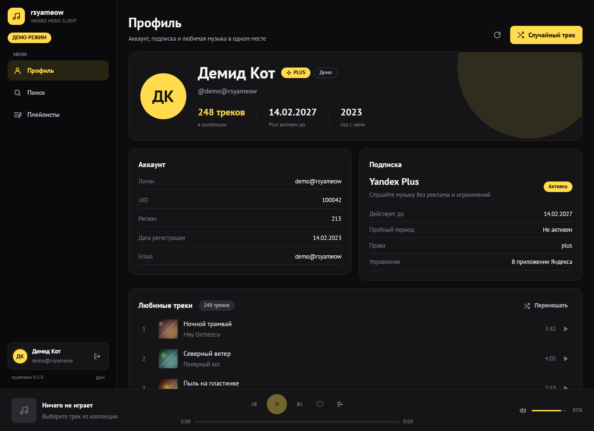

## Возможности

- **Авторизация через OAuth Device Flow.** Пароль вводится только на сайте
  Яндекса, приложение получает токен и сохраняет его локально с правами `0600`.
  Также можно передать готовый токен через `--token` или `YANDEX_MUSIC_TOKEN`.
- **Профиль.** Открывается кликом по карточке аккаунта внизу сайдбара. Имя,
  логин, UID, регион, дата регистрации, статус Plus и подписка; отдельная
  карточка ведёт в любимые треки.
- **Любимые треки.** Отдельная вкладка со всей коллекцией «Мне нравится»
  (первые 24 трека загружаются сразу, остальные — бесконечно при прокрутке),
  запуском и перемешиванием.
- **Лайки.** Сердце в плеере и на странице трека ставит и снимает отметку
  «Мне нравится», обновляя коллекцию и профиль.
- **Плейлисты.** Список плейлистов аккаунта с обложками, страница плейлиста
  с треками, запуск всего плейлиста или вперемешку. Треки длинного плейлиста
  догружаются бесконечно при прокрутке. Обе страницы используют иммерсивный
  фон из обложки плейлиста.
- **Мои альбомы.** Вкладка с сохранёнными альбомами из коллекции: обложки,
  исполнители, год и количество треков; клик открывает страницу альбома.
- **Очередь.** Боковая панель с текущим и предстоящими треками: можно перейти
  к любой композиции. Для длинных очередей показывается окно вокруг текущего
  трека, а названия догружаются по API.
- **Поиск по каталогу.** Вкладки «Треки», «Исполнители» и «Альбомы»,
  пагинация и обложки. Поиск запускается сам через 400 мс после ввода
  (кнопки «Найти» нет), Enter и переключение вкладки ищут сразу. Поле
  поддерживает Ctrl+A, Ctrl+C/X/V, стрелки, Home/End; каретка стоит в конце
  при клике. Клик по исполнителю открывает его страницу, по альбому — страницу
  альбома. В демо-режиме поиск работает локально.
- **Страницы артиста и альбома.** Обложка, жанры и счётчики артиста (включая
  количество лайков); на странице артиста видны первые 10 треков и
  горизонтальная лента из 10 альбомов.
  Футеры «Все треки» и «Все альбомы» открывают отдельные вкладки с полной
  дискографией. Фон страниц артиста и альбома — 4 radial gradient из обложки
  с размытой подложкой. Страница альбома — треки, год, длительность и переход
  к артисту. Навигация «назад» возвращает на предыдущий экран.
- **Страница трека.** Открывается кликом по названию в любом списке (без
  запуска воспроизведения). Компактный хедер:
  обложка, название, исполнитель и альбом со ссылками, длительность и, для
  текущего трека, позиция прослушивания. Ниже загружается текст песни, если он
  есть; при его отсутствии блок не показывается. Длинный текст ограничен по
  высоте, затемняется снизу и раскрывается кнопкой «Показать полностью». Дублирующая карточка «О треке»
  убрана. Фон — четыре статичных radial gradient из цветов обложки поверх
  размытой подложки, без анимации; карточки с димом. Для треков без обложки
  используется жёлтая палитра Яндекса.
- **Сейчас играет.** Отдельная страница текущего трека из плеера или пункта
  меню «Сейчас играет»; не зависит от выбранного в списке трека. Фон — четыре
  статичных radial gradient, построенных по цветам обложки текущего трека.
- **Моя волна.** Персональный поток `user:onyourwave`: полноэкранный постер
  текущего трека с крупной обложкой, переключением, лайком и прогрессом.
  Описание и список очереди скрыты. Прогресс можно перематывать слайдером, а
  кнопки выровнены по центральной паузе. Следующая партия догружается
  автоматически, а уже знакомые треки отфильтровываются, чтобы очередь не
  ломалась. Текущий,
  предыдущий и следующий треки предзагружаются в фоне, поэтому переключения
  почти мгновенные. При перезапуске текущий трек и его обложка тоже загружаются
  заранее.
- **Случайный трек.** Кнопка выбирает случайную композицию из «Мне нравится»,
  получает подписанный файл (FLAC, если доступен, иначе MP3) и запускает
  воспроизведение.
- **Lossless.** Для треков, доступных в lossless, клиент запрашивает FLAC
  через подписанный `/get-file-info` (`flac-mp4`) и автоматически откатывается
  на MP3, если FLAC нет или подписка не позволяет. Качество видно в плеере.
- **Плеер.** Обложка, название, исполнитель, прогресс, пауза/продолжение,
  предыдущий и следующий трек, перемотка драгом по центральной области: прогресс — заливка фона, тултип привязан к прогрессу; громкость перетаскиванием (квадратичная кривая громкости), мьют,
  лайк и кнопка очереди. Клик по треку открывает его страницу. При выборе
  другого трека предыдущий сразу останавливается, даже если новый ещё
  загружается. По окончании трека включается следующий. Аудио выводится через
  [rodio](https://github.com/RustAudio/rodio).
- **Списки треков.** Название открывает страницу трека, имя исполнителя —
  страницу артиста; при наведении ссылки подчёркиваются. В плеере название и
  исполнитель текущего трека тоже кликабельны и подчёркиваются. У текущего
  трека вместо номера анимированный эквалайзер; при наведении на строку слева
  появляется кнопка Play. Треки с explicit помечены значком `E` в списках,
  очереди, плеере и на странице трека.
- **Демо-режим.** Полноценный интерфейс с вымышленными треками, обложками и
  симуляцией воспроизведения — без сети и токена. Удобно для скриншотов и
  разработки UI. Отображаемое имя приложения — **Я.Мяу**, иконка — кошачья
  лапка.
- **Схлопываемое меню.** Сайдбар сворачивается до иконок; состояние
  сохраняется между запусками.
- **Скругления.** Постеры и обложки скруглены во всех списках, карточках и
  плеере; окно приложения имеет скруглённые углы с тонкой рамкой.
- **Обновление «Любимых».** Кнопка обновления перезагружает только коллекцию,
  не меняя экран и не останавливая воспроизведение.
- **Собственный заголовок окна.** Перетаскивание за шапку, двойной клик —
  максимизация, кнопки «свернуть / развернуть / закрыть», изменение размера
  перетаскиванием за края и углы. Работает и в Wayland-композиторах без
  серверных декораций.
- **Сохранение состояния.** При следующем запуске восстанавливаются экран
  (включая страницы артиста/альбома/трека/плейлиста, «Сейчас играет» и выбранный трек),
  поисковый запрос, очередь, текущий трек и позиция. Трек восстанавливается на
  паузе, его обложка и аудио предзагружаются, а Play запускает почти сразу.
  Состояние хранится в `state.json` с правами `0600`.
- **Адаптивное окно.** Раскладка перестраивается при изменении размера
  (карточки аккаунта и подписки становятся одноколоночными), а размер окна
  запоминается между запусками в `window.json`. Громкость сохраняется в
  `playback.json`.

## Скриншоты

<p>
  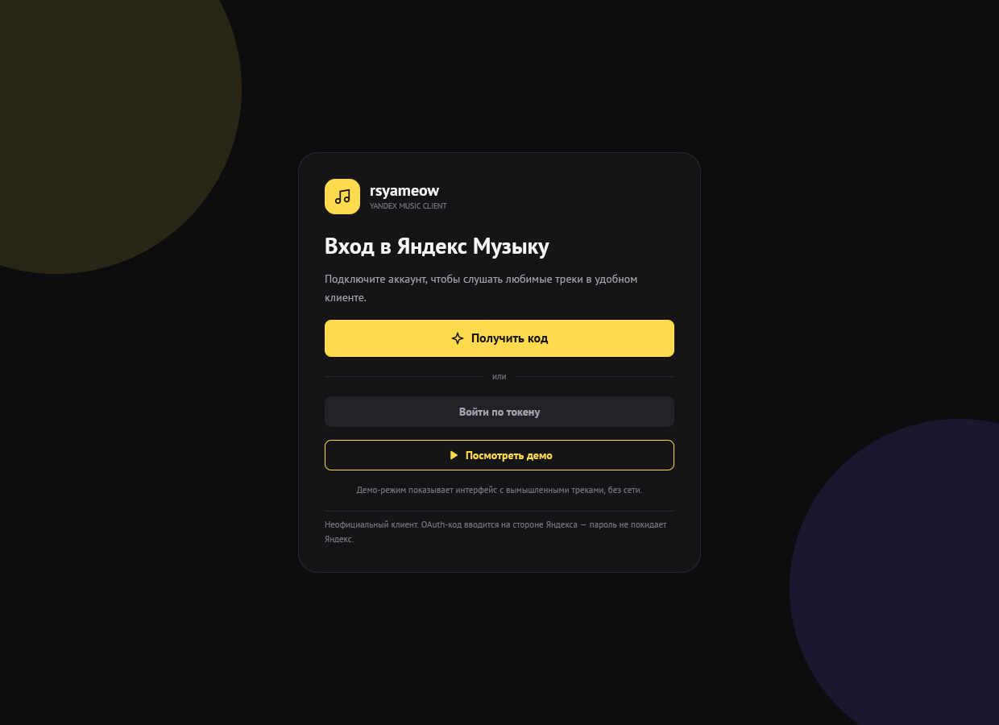
  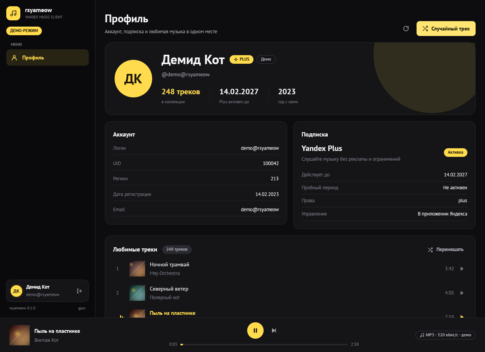
</p>


<p>
  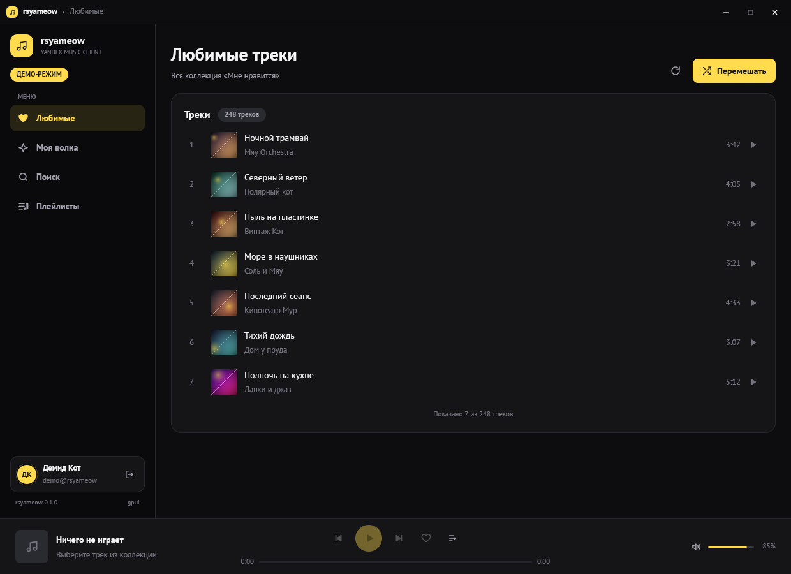
  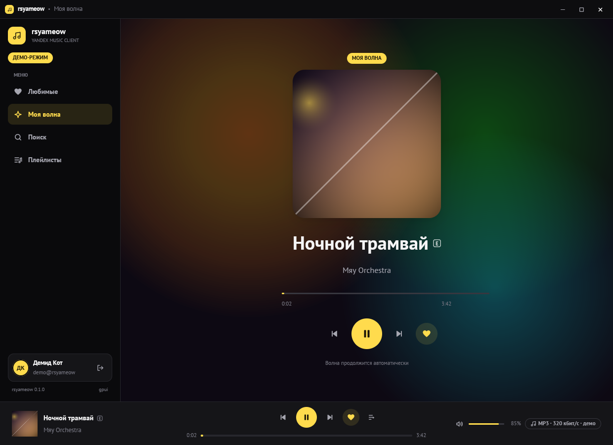
</p>

<p>
  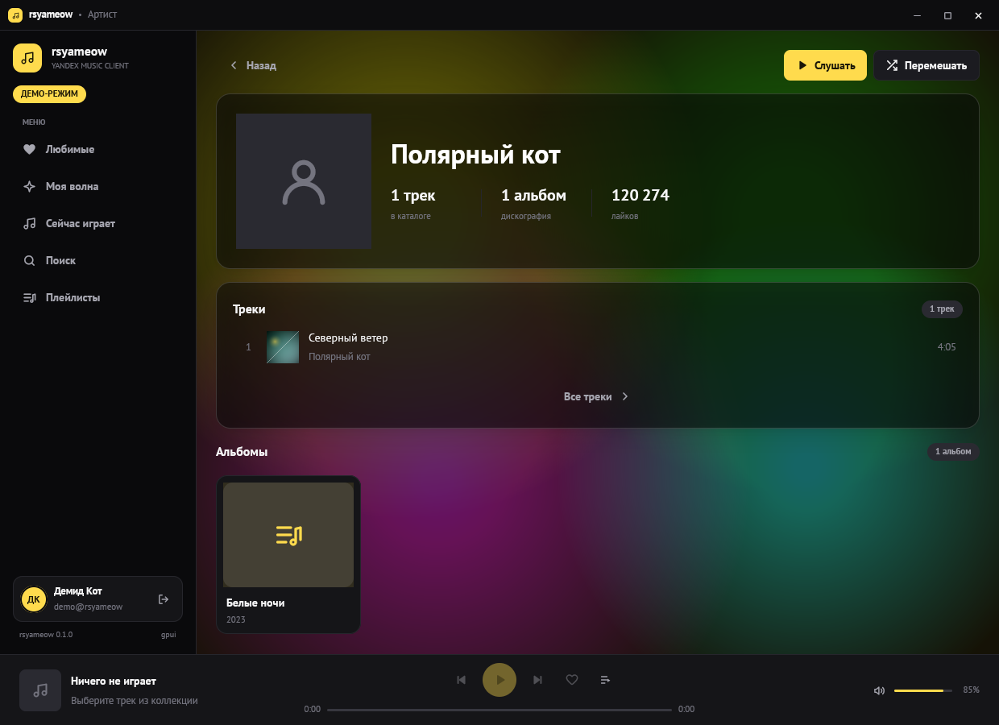
  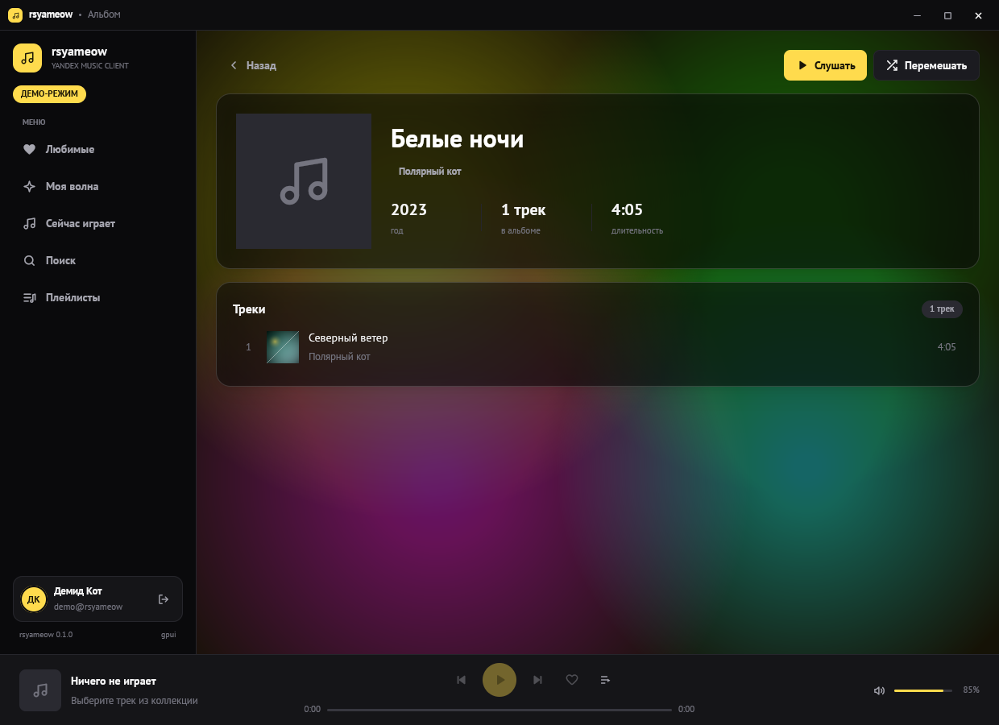
</p>

<p>
  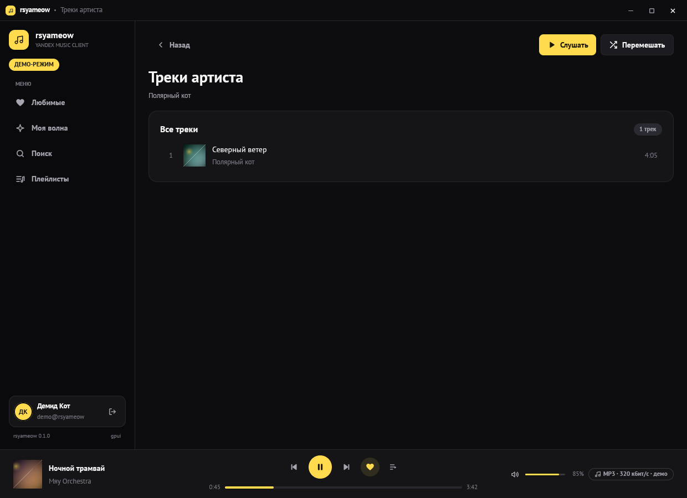
  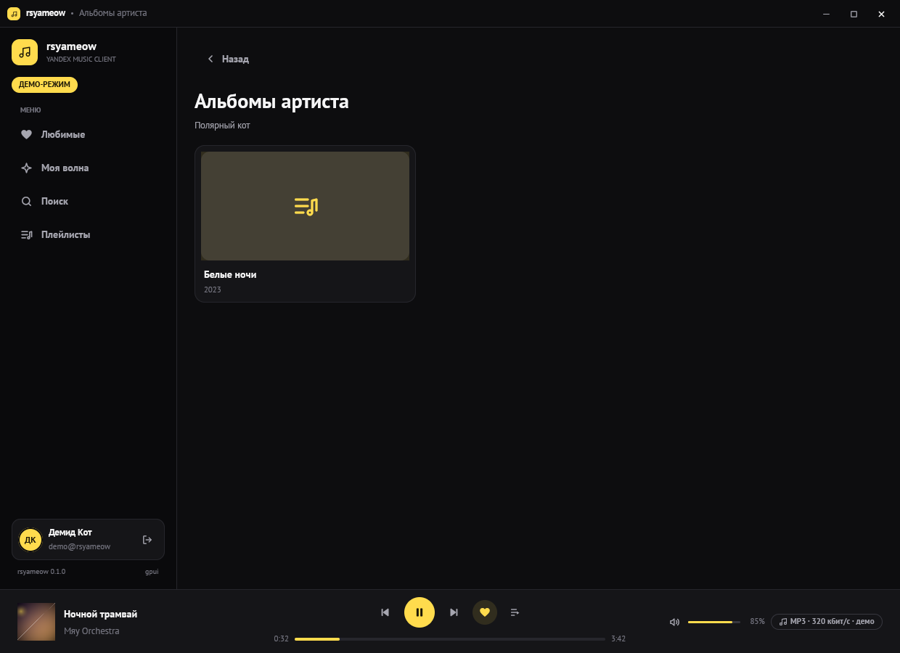
</p>

<p>
  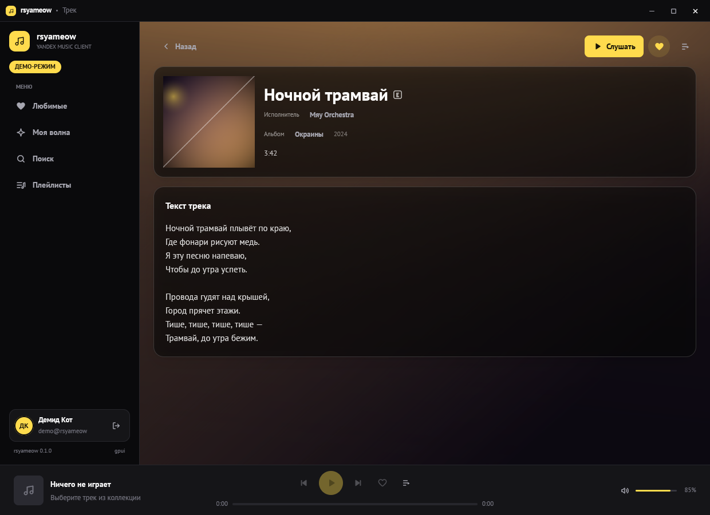
  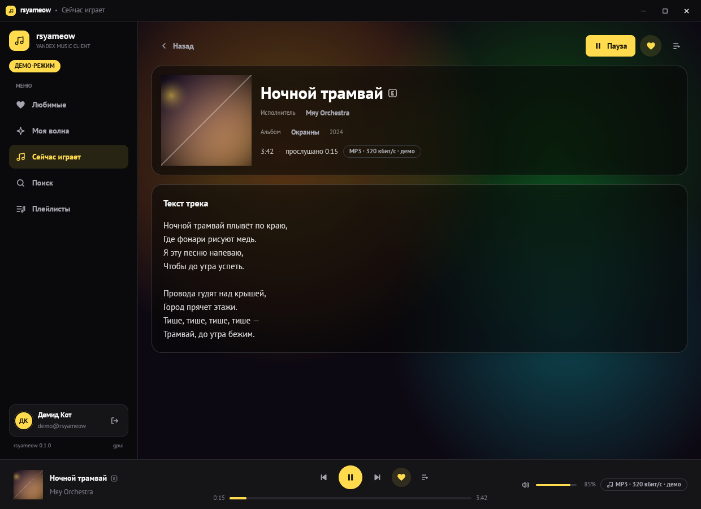
</p>

<p>
  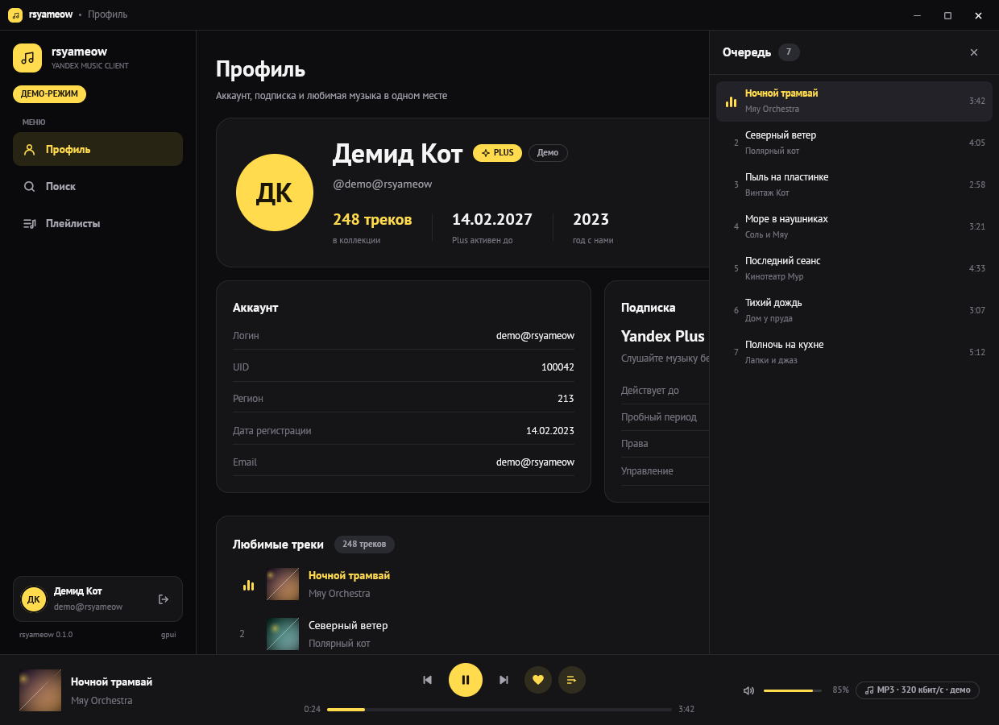
</p>

<p>
  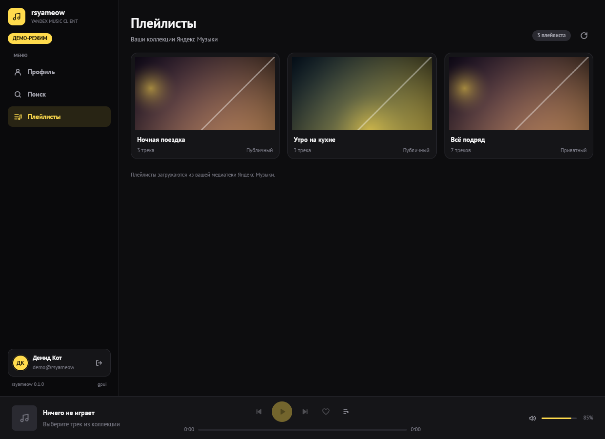
  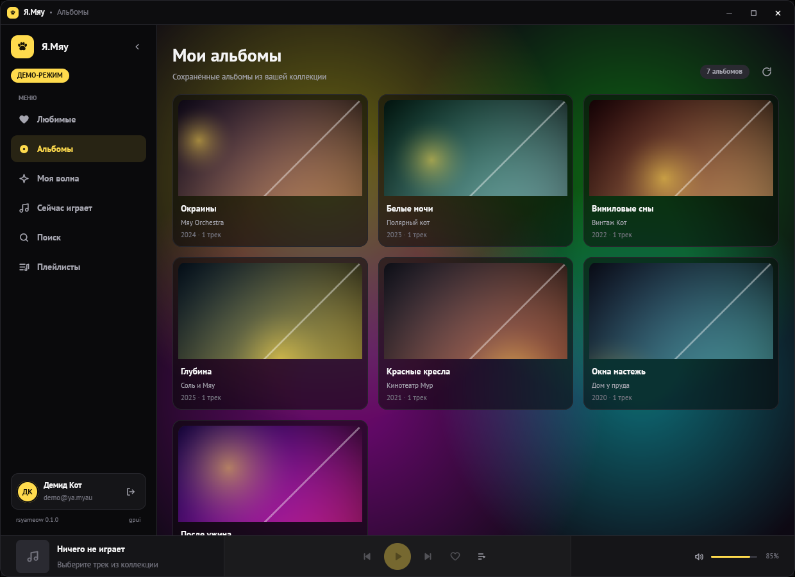
  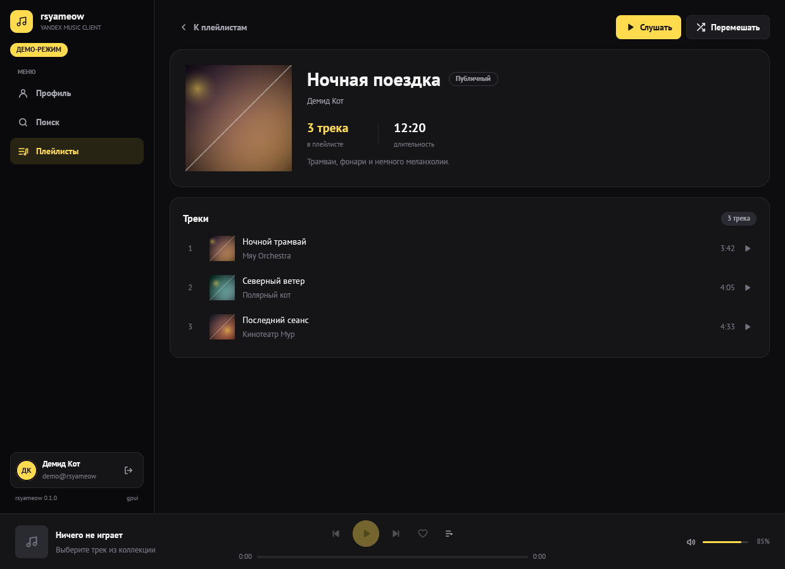
</p>

## Горячие клавиши

| Клавиши | Действие |
| --- | --- |
| `Ctrl+Space` | пауза / продолжить |
| `Ctrl+←` / `Ctrl+→` | предыдущий / следующий трек |
| `Ctrl+M` | выключить / вернуть звук |
| `Ctrl+Q` | открыть / закрыть очередь |
| `Ctrl+F` | перейти к поиску и поставить курсор в поле |
| `Ctrl+W` | закрыть окно |
| `Esc` | закрыть очередь |

## Структура репозитория

```
crates/
  app/
    src/
      app/          # состояние, роутинг, auth, playback, поиск, волна, плейлисты
        mod.rs      # RootView, экраны, тикер
        auth.rs     # OAuth, вход и выход
        playback.rs # очередь, загрузка аудио, seek
        search.rs   # debounce и пагинация поиска
        wave.rs     # «Моя волна» и предзагрузка соседей
        ...         # profile/likes/artist/album/track/playlists/state/covers
      view/         # экраны и переиспользуемые элементы интерфейса
        shell.rs    # titlebar, sidebar, player bar
        widgets.rs  # карточки, обложки, radial-фон
        ...         # profile, liked, search, artist, album, track, wave
      audio.rs      # rodio
      config.rs     # сессия, state.json, громкость, окно
      demo.rs       # демо-библиотека
      main.rs       # CLI и запуск приложения
  yandex-music/     # клиент API, порт Python-библиотеки yandex-music-api
  ui/               # rsyameow-ui: тема и переиспользуемые gpui-компоненты
docs/screenshots/
third_party/xattr   # пропатченная зависимость gpui (см. ниже)
```

| Крейт | Пакет | Назначение |
| --- | --- | --- |
| Приложение | `rsyameow` | окно, роутинг экранов, авторизация, загрузка треков, audio engine |
| Клиент | `yandex-music` | синхронный, потокобезопасный клиент Yandex Music API |
| UI kit | `rsyameow-ui` | `Theme`, кнопки, бейджи, аватары, прогресс-бар, строки треков, плеер, текстовое поле |

Клиент не зависит от UI, а UI-кит не знает о Яндекс Музыке: он работает только
с цветами, шрифтами, картинками и колбэками.

## Требования

- Linux с работающим Vulkan-драйвером (Intel/AMD Mesa, NVIDIA или программный
  lavapipe).
- Rust stable 1.90+ (edition 2024; проверено на 1.100).
- X11 или Wayland.
- PipeWire, PulseAudio или ALSA для звука.

Ubuntu/Debian:

```bash
sudo apt install build-essential pkg-config \
  libxkbcommon-dev libxkbcommon-x11-dev libxcb1-dev libx11-dev libwayland-dev \
  libfontconfig1-dev libfreetype-dev libpng-dev libbrotli-dev \
  libexpat1-dev zlib1g-dev libasound2-dev libvulkan1 mesa-vulkan-drivers
```

Для NVIDIA нужен проприетарный драйвер с Vulkan. Без GPU подойдёт
`mesa-vulkan-drivers` (lavapipe), но интерфейс будет заметно медленнее.

## Сборка и запуск

```bash
# демо без аккаунта и без сети
cargo run -p rsyameow -- --demo

# обычный запуск; если токен уже сохранён — вход произойдёт автоматически
cargo run -p rsyameow

# токен из переменной окружения или аргумента
YANDEX_MUSIC_TOKEN='y0_...' cargo run -p rsyameow
cargo run -p rsyameow -- --token 'y0_...'
```

Другие флаги: `--help`, `--version`.

Релизная сборка:

```bash
cargo build --release -p rsyameow
./target/release/rsyameow
```

### Установка для текущего пользователя

```bash
./scripts/install-linux.sh
```

Скрипт собирает релизный бинарник и устанавливает его без `sudo`:

- `~/.local/bin/rsyameow`;
- `~/.local/share/applications/ya-myau.desktop` — пункт «Я.Мяу» в меню приложений;
- `~/.local/share/icons/hicolor/scalable/apps/rsyameow.svg` — иконка.

Дополнительно:

```bash
# другой префикс
./scripts/install-linux.sh --prefix "$HOME/.local"

# использовать уже собранный target/release/rsyameow
./scripts/install-linux.sh --no-build

# удалить установленные файлы
./scripts/install-linux.sh --uninstall
```

Если `~/.local/bin` не входит в `PATH`, скрипт подскажет, как его добавить.

## Авторизация

1. Нажмите **«Получить код»**.
2. Приложение покажет `user_code` и откроет страницу подтверждения Яндекса по
   кнопке **«Открыть страницу»**.
3. Введите код на сайте Яндекса и подтвердите доступ.
4. Приложение раз в несколько секунд опрашивает OAuth-сервер, получает токен и
   сохраняет его в `~/.config/rsyameow/session.json` (или в
   `$XDG_CONFIG_HOME/rsyameow/`, или в `$RSYAMEOW_CONFIG_DIR`). Файл сессии
   получает права `0600`, в том числе если он был создан вручную.

Используются публичные OAuth-креды официального Android-приложения Яндекс
Музыки, как и в Python-библиотеке `yandex-music-api`. Пароль от аккаунта
приложению не передаётся.

Выход из аккаунта удаляет сохранённый токен с диска.

## Клиент API

Реализовано подмножество API, необходимое клиенту:

| Возможность | Endpoint |
| --- | --- |
| Device code | `POST https://oauth.yandex.ru/device/code` |
| OAuth token | `POST https://oauth.yandex.ru/token` |
| Статус аккаунта | `GET /account/status` |
| Поиск | `GET /search?type=track\|artist\|album` |
| Лайк / анлайк | `POST /users/{uid}/likes/tracks/add-multiple` / `remove` |
| Плейлисты | `GET /users/{uid}/playlists/list` и `/users/{uid}/playlists/{kind}` |
| Артист | `GET /artists/{id}/brief-info`, `/tracks`, `/direct-albums` |
| Альбом | `GET /albums/{id}/with-tracks` |
| Моя волна | `GET /rotor/station/user:onyourwave/tracks` |
| Любимые треки | `GET /users/{uid}/likes/tracks` |
| Полные треки | `POST /tracks` |
| Варианты загрузки | `GET /tracks/{id}/download-info` |
| Подписанная ссылка MP3 | XML + MD5-подпись `get-mp3/{sign}/{ts}{path}` |
| Lossless-файл | `GET /get-file-info` + HMAC-SHA256-подпись desktop-клиента |
| Текст трека | `GET /tracks/{id}/lyrics` + подписанная ссылка на текст |
| Обложки | `https://<coverUri>` |

Портируются модели `Account`, `Status`, `Permissions`, `Plus`, `Subscription`,
`Track`, `TrackShort`, `TracksList`, `Artist`, `ArtistTracks`, `ArtistAlbums`,
`Album`, `Pager`, `Playlist`, `User`, `WaveBatch`, `WaveSequence`, `Cover`,
`SearchResult`, `TrackLyrics`, `LyricsMajor`, `DownloadInfo`, `FileInfo`,
`FileDownloadInfo`, `DeviceCode`, `OAuthToken`. Формат запросов и подписи прямых ссылок повторяет
[`MarshalX/yandex-music-api`](https://github.com/MarshalX/yandex-music-api).

Пример использования:

```rust
use yandex_music::Client;

fn main() -> Result<(), Box<dyn std::error::Error>> {
    let client = Client::with_token(std::env::var("YANDEX_MUSIC_TOKEN")?);
    client.init()?;

    let liked = client.liked_tracks()?;
    if let Some(short) = liked.tracks.first() {
        let track = client.track(&short.track_id())?;
        let audio = client.download_track(&track.id)?;
        std::fs::write("song.mp3", audio.bytes)?;
    }
    Ok(())
}
```

Готовый smoke-тест:

```bash
YANDEX_MUSIC_TOKEN='y0_...' cargo run -p yandex-music --example smoke
```

## Тесты и проверки

```bash
cargo test --workspace
cargo clippy --workspace --all-targets
cargo fmt --all --check
```

Клиент тестируется на локальном HTTP-сервере без внешней сети: проверяются
разбор ответов, повторяющиеся поля формы, OAuth pending/success, коды ошибок,
поиск треков/исполнителей/альбомов, плейлисты, лайки, страницы артистов и
альбомов, «Моя волна», текст трека, построение MD5- и HMAC-подписей,
lossless-загрузка и обложки. Авторизация device flow дополнительно проверена вручную против
настоящего OAuth-сервера Яндекса. Живые сценарии требуют токена и в CI не
запускаются.

## Известные ограничения

- «Случайный трек» выбирается только из коллекции «Мне нравится». Для пустой
  коллекции показывается подсказка.
- Качество выбирается автоматически: FLAC (lossless) при наличии Plus и
  lossless-версии трека, иначе MP3. Ручного переключателя качества, кэша и
  офлайна нет; FLAC занимает заметно больше трафика.
- Очередь последовательная: «Перемешать» выбирает случайный стартовый трек,
  но дальше воспроизведение идёт по порядку плейлиста. Для очередей длиннее
  40 треков панель показывает окно вокруг текущего.
- «Моя волна» не отправляет дизлайки и не настраивает настроение или энергию;
  догрузка идёт по последнему треку скрытой очереди. Уже знакомые треки при
  догрузке отбрасываются, поэтому при пустой выдаче волна может остановиться.
- На странице артиста показываются первые 10 треков и 10 альбомов, а вкладки
  «Все треки»/«Все альбомы» догружают до 1000 записей; более длинную
  дискографию API приходится листать вручную за пределами клиента.
- На странице трека нет клипа и похожих треков. Градиент считается по обложке;
  для однотонных обложек используется жёлтый акцент, а размытие подложки —
  программное, без backdrop-filter.
- Признака lossless нет в ответах поиска и списков треков: его можно узнать
  только отдельным запросом `/get-file-info`. Поэтому иконки lossless в списках
  нет; качество показывается бейджем в плеере и на странице трека после загрузки.
- В плейлисте отображаются первые 50–100 треков (столько отдаёт API за один
  запрос); пагинация плейлиста пока не сделана.
- Во вкладке «Любимые» показываются 24 последних трека, хотя счётчик отражает
  всю коллекцию.
- Состояние сохраняет экран, выбранный трек, очередь и позицию, но не позицию
  прокрутки; результаты поиска загружаются заново после запроса.
- Текстовое поле поддерживает набор, Backspace/Delete, Enter, вставку,
  выделение Ctrl+A, копирование/вырезание и перемещение стрелками, но не IME,
  не Shift-выделение и не выделение мышью; клик ставит каретку в конец.
- Токен не обновляется автоматически; при истечении нужно войти заново.
- macOS и Windows не тестировались, хотя gpui и rodio их поддерживают.
- API Яндекс Музыки неофициальный и может измениться без предупреждения.

## Почему пропатчен `xattr`

`gpui 0.2.2` тянет `zed-async-tar`, который зависит от `xattr 0.2.3`. В свежих
версиях `libc` константа `ENOATTR` больше не определена для Linux, из-за чего
`xattr` не собирается. В `third_party/xattr` лежит исправленная копия, где на
Linux и Android используется эквивалентная `ENODATA`; патч подключён через
`[patch.crates-io]` в корневом `Cargo.toml`.

## Лицензии и дисклеймер

Код проекта распространяется по лицензии MIT (см. [LICENSE](LICENSE)).
Шрифт PT Sans — OFL, текст лицензии лежит в
`crates/app/assets/fonts/OFL.txt`. Зависимости и пропатченный `xattr` сохраняют
свои лицензии (Apache-2.0 / MIT).

Проект не связан с Яндексом и не одобрен им. «Яндекс» и «Яндекс Музыка» —
товарные знаки их владельцев. Используйте клиент в соответствии с условиями
сервиса Яндекс Музыки.
