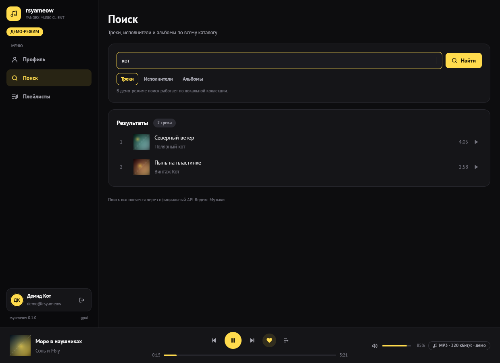

# rsyameow

Неофициальный клиент Яндекс Музыки для Linux, написанный на Rust и
[gpui](https://gpui.rs) — GPU-ускоренном UI-фреймворке из редактора Zed.

Проект находится в стадии MVP: уже можно войти в аккаунт, посмотреть профиль и
подписку, увидеть любимые треки и включить случайную песню из коллекции «Мне
нравится».


## Возможности

- **Авторизация через OAuth Device Flow.** Пароль вводится только на сайте
  Яндекса, приложение получает токен и сохраняет его локально с правами `0600`.
  Также можно передать готовый токен через `--token` или `YANDEX_MUSIC_TOKEN`.
- **Страница профиля.** Имя, логин, UID, регион, дата регистрации, статус
  Yandex Plus и срок действия подписки, счётчик любимых треков.
- **Лайки.** Сердце в плеере ставит и снимает отметку «Мне нравится»,
  обновляя коллекцию и профиль.
- **Плейлисты.** Список плейлистов аккаунта с обложками, страница плейлиста
  с треками, запуск всего плейлиста или вперемешку.
- **Очередь.** Боковая панель с текущим и предстоящими треками: можно перейти
  к любой композиции. Для длинных очередей показывается окно вокруг текущего
  трека, а названия догружаются по API.
- **Поиск по каталогу.** Поиск треков через `/search`, результаты с обложками,
  пагинацией и воспроизведением. В демо-режиме поиск работает локально по
  демо-коллекции.
- **Любимые треки.** Загружаются из библиотеки аккаунта (до 24 последних),
  показываются с обложками, длительностью и подсветкой текущего трека.
- **Случайный трек.** Кнопка выбирает случайную композицию из «Мне нравится»,
  получает подписанную ссылку у API, скачивает MP3 и запускает воспроизведение.
- **Плеер.** Обложка, название, исполнитель, прогресс, пауза/продолжение,
  предыдущий и следующий трек, перемотка кликом по полосе прогресса, громкость
  и мьют. Очередь строится из «Мне нравится», а по окончании трека включается
  следующий. Аудио выводится через [rodio](https://github.com/RustAudio/rodio).
- **Демо-режим.** Полноценный интерфейс с вымышленными треками, обложками и
  симуляцией воспроизведения — без сети и токена. Удобно для скриншотов и
  разработки UI.
- **Адаптивное окно.** Раскладка перестраивается при изменении размера
  (карточки аккаунта и подписки становятся одноколоночными), а размер окна
  запоминается между запусками в `window.json`. Громкость сохраняется в
  `playback.json`.

<p>
  
  
</p>



## Структура репозитория

```
crates/
  app/            # rsyameow: точка входа, состояние приложения, плеер, конфиг
  yandex-music/   # yandex-music: клиент API, порт Python-библиотеки yandex-music-api
  ui/             # rsyameow-ui: тема и переиспользуемые gpui-компоненты
docs/screenshots/
third_party/xattr # пропатченная зависимость gpui (см. ниже)
```

| Крейт | Пакет | Назначение |
| --- | --- | --- |
| Приложение | `rsyameow` | окно, роутинг экранов, авторизация, загрузка треков, audio engine |
| Клиент | `yandex-music` | синхронный, потокобезопасный клиент Yandex Music API |
| UI kit | `rsyameow-ui` | `Theme`, кнопки, бейджи, аватары, прогресс-бар, строки треков, плеер, текстовое поле |

Клиент не зависит от UI, а UI-кит не знает о Яндекс Музыке: он работает только
с цветами, шрифтами, картинками и колбэками.

## Требования

- Linux с работающим Vulkan-драйвером (Intel/AMD Mesa, NVIDIA или программный
  lavapipe).
- Rust stable 1.90+ (edition 2024; проверено на 1.100).
- X11 или Wayland.
- PipeWire, PulseAudio или ALSA для звука.

Ubuntu/Debian:

```bash
sudo apt install build-essential pkg-config \
  libxkbcommon-dev libxkbcommon-x11-dev libxcb1-dev libx11-dev libwayland-dev \
  libfontconfig1-dev libfreetype-dev libpng-dev libbrotli-dev \
  libexpat1-dev zlib1g-dev libasound2-dev libvulkan1 mesa-vulkan-drivers
```

Для NVIDIA нужен проприетарный драйвер с Vulkan. Без GPU подойдёт
`mesa-vulkan-drivers` (lavapipe), но интерфейс будет заметно медленнее.

## Сборка и запуск

```bash
# демо без аккаунта и без сети
cargo run -p rsyameow -- --demo

# обычный запуск; если токен уже сохранён — вход произойдёт автоматически
cargo run -p rsyameow

# токен из переменной окружения или аргумента
YANDEX_MUSIC_TOKEN='y0_...' cargo run -p rsyameow
cargo run -p rsyameow -- --token 'y0_...'
```

Другие флаги: `--help`, `--version`.

Релизная сборка:

```bash
cargo build --release -p rsyameow
./target/release/rsyameow
```

## Авторизация

1. Нажмите **«Получить код»**.
2. Приложение покажет `user_code` и откроет страницу подтверждения Яндекса по
   кнопке **«Открыть страницу»**.
3. Введите код на сайте Яндекса и подтвердите доступ.
4. Приложение раз в несколько секунд опрашивает OAuth-сервер, получает токен и
   сохраняет его в `~/.config/rsyameow/session.json` (или в
   `$XDG_CONFIG_HOME/rsyameow/`, или в `$RSYAMEOW_CONFIG_DIR`). Файл сессии
   получает права `0600`, в том числе если он был создан вручную.

Используются публичные OAuth-креды официального Android-приложения Яндекс
Музыки, как и в Python-библиотеке `yandex-music-api`. Пароль от аккаунта
приложению не передаётся.

Выход из аккаунта удаляет сохранённый токен с диска.

## Клиент API

Реализовано подмножество, необходимое MVP:

| Возможность | Endpoint |
| --- | --- |
| Device code | `POST https://oauth.yandex.ru/device/code` |
| OAuth token | `POST https://oauth.yandex.ru/token` |
| Статус аккаунта | `GET /account/status` |
| Поиск треков | `GET /search?type=track` |
| Лайк / анлайк | `POST /users/{uid}/likes/tracks/add-multiple` / `remove` |
| Плейлисты | `GET /users/{uid}/playlists/list` и `/users/{uid}/playlists/{kind}` |
| Любимые треки | `GET /users/{uid}/likes/tracks` |
| Полные треки | `POST /tracks` |
| Варианты загрузки | `GET /tracks/{id}/download-info` |
| Подписанная ссылка | XML + MD5-подпись `get-mp3/{sign}/{ts}{path}` |
| Обложки | `https://<coverUri>` |

Портируются модели `Account`, `Status`, `Permissions`, `Plus`, `Subscription`,
`Track`, `Artist`, `Album`, `TrackShort`, `TracksList`, `DownloadInfo`,
`DeviceCode`, `OAuthToken`. Формат запросов и подписи прямых ссылок повторяет
[`MarshalX/yandex-music-api`](https://github.com/MarshalX/yandex-music-api).

Пример использования:

```rust
use yandex_music::Client;

fn main() -> Result<(), Box<dyn std::error::Error>> {
    let client = Client::with_token(std::env::var("YANDEX_MUSIC_TOKEN")?);
    client.init()?;

    let liked = client.liked_tracks()?;
    if let Some(short) = liked.tracks.first() {
        let track = client.track(&short.track_id())?;
        let audio = client.download_track(&track.id)?;
        std::fs::write("song.mp3", audio.bytes)?;
    }
    Ok(())
}
```

Готовый smoke-тест:

```bash
YANDEX_MUSIC_TOKEN='y0_...' cargo run -p yandex-music --example smoke
```

## Тесты и проверки

```bash
cargo test --workspace
cargo clippy --workspace --all-targets
cargo fmt --all --check
```

Клиент тестируется на локальном HTTP-сервере без внешней сети: проверяются
разбор ответов, повторяющиеся поля формы, OAuth pending/success, коды ошибок,
построение MD5-подписи и загрузка обложек. Авторизация device flow была
дополнительно проверена вручную против настоящего OAuth-сервера Яндекса.
Живой сценарий «профиль → трек» требует действующего токена и в CI не
запускается.

## Известные ограничения

- «Случайный трек» выбирается только из коллекции «Мне нравится». Для пустой
  коллекции показывается подсказка.
- Скачивается только полный MP3; lossless и выбор качества не реализованы.
- Очередь последовательная: «Перемешать» выбирает случайный стартовый трек,
  но дальше воспроизведение идёт по порядку коллекции.
- Нет поиска, плейлистов, «Моей волны», управления лайками, очереди, кэша и
  офлайн-режима.
- Текстовое поле поддерживает набор, Backspace, Enter и вставку, но не IME и не
  выделение мышью — этого достаточно для токена и поискового запроса.
- Поиск треков поддерживает пагинацию; поиск по исполнителям и альбомам пока
  не реализован.
- В плейлисте отображаются первые 50–100 треков (столько отдаёт API за один
  запрос); пагинация плейлиста пока не сделана.
- Токен не обновляется автоматически; при истечении нужно войти заново.
- macOS и Windows не тестировались, хотя gpui и rodio их поддерживают.
- API Яндекс Музыки неофициальный и может измениться без предупреждения.

## Почему пропатчен `xattr`

`gpui 0.2.2` тянет `zed-async-tar`, который зависит от `xattr 0.2.3`. В свежих
версиях `libc` константа `ENOATTR` больше не определена для Linux, из-за чего
`xattr` не собирается. В `third_party/xattr` лежит исправленная копия, где на
Linux и Android используется эквивалентная `ENODATA`; патч подключён через
`[patch.crates-io]` в корневом `Cargo.toml`.

## Лицензии и дисклеймер

Код проекта распространяется по лицензии MIT (см. [LICENSE](LICENSE)).
Шрифт PT Sans — OFL, текст лицензии лежит в
`crates/app/assets/fonts/OFL.txt`. Зависимости и пропатченный `xattr` сохраняют
свои лицензии (Apache-2.0 / MIT).

Проект не связан с Яндексом и не одобрен им. «Яндекс» и «Яндекс Музыка» —
товарные знаки их владельцев. Используйте клиент в соответствии с условиями
сервиса Яндекс Музыки.
